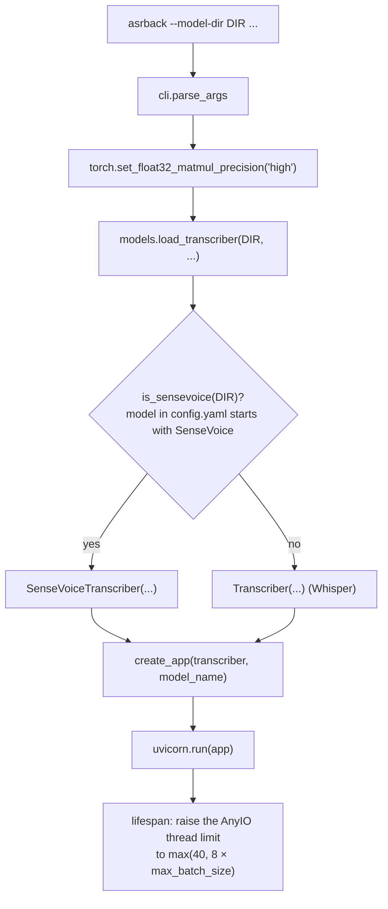
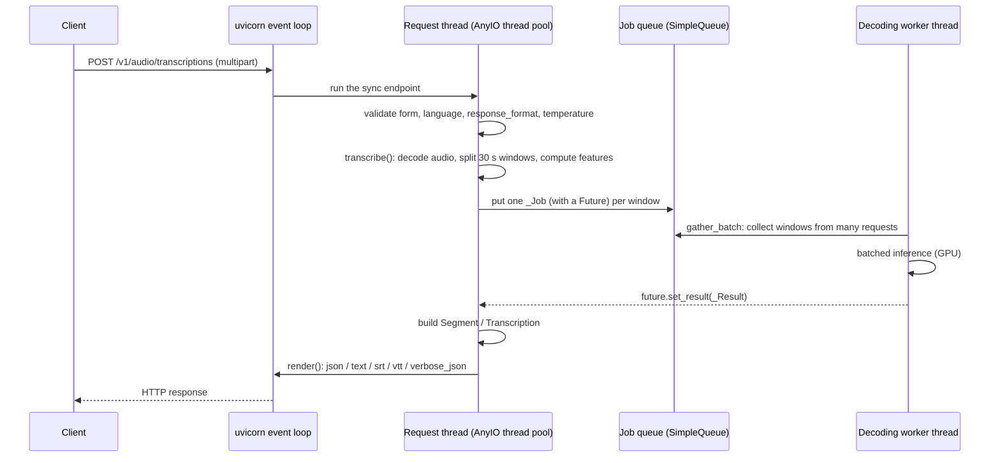
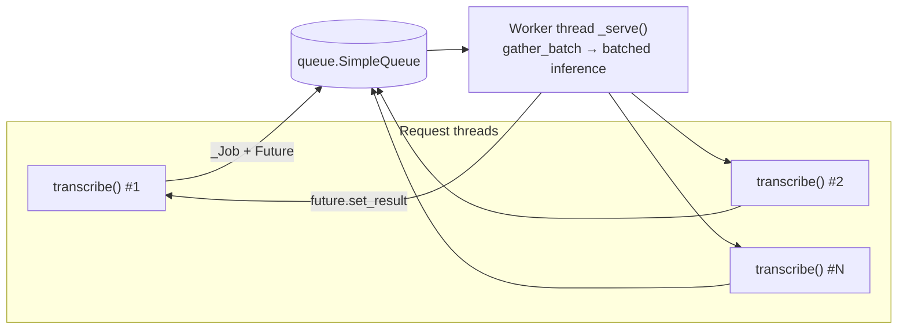
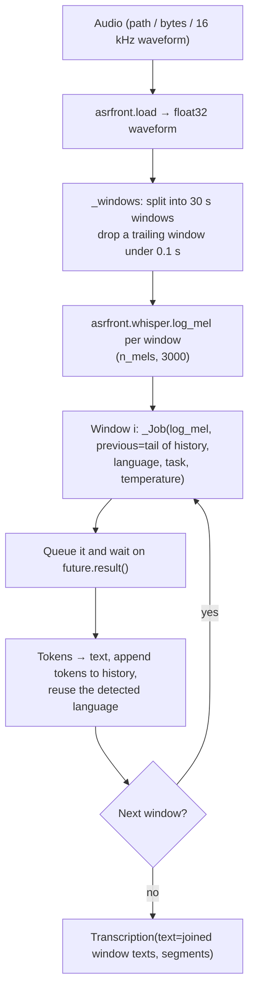
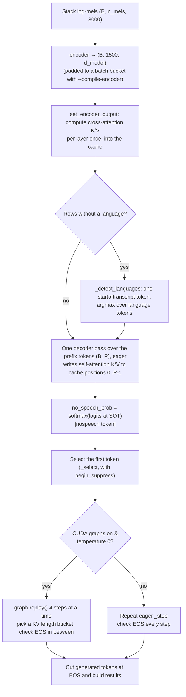
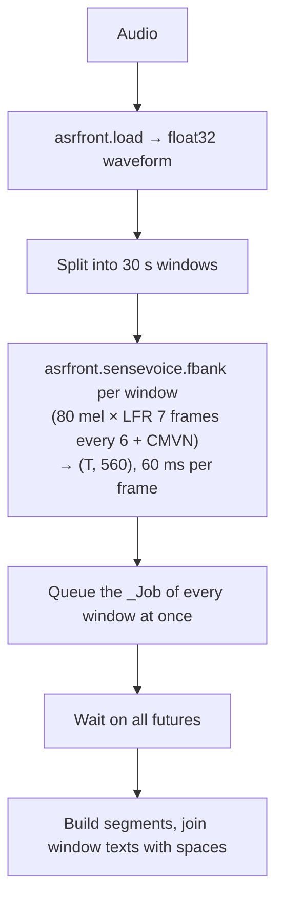
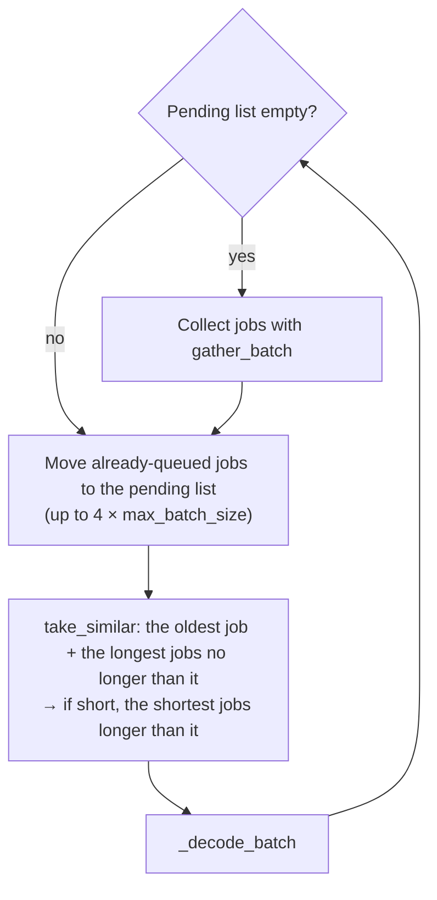
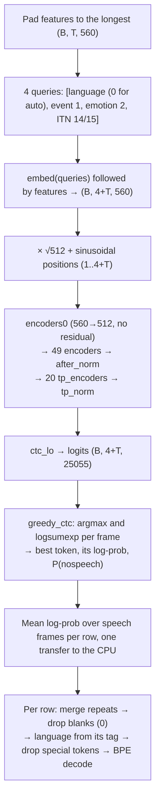
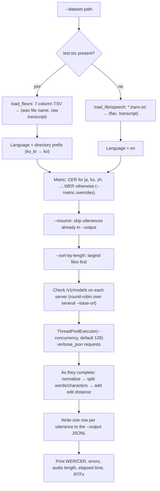

# asrback system flow

This document follows the code of the `asrback` package from server startup to request handling,
speech recognition and response. It also covers the evaluation tool (`asrback-eval`) and the
interactive client (`asrback-client`).

- [1. Package layout](#1-package-layout)
- [2. Server startup](#2-server-startup)
- [3. Request handling](#3-request-handling)
- [4. Concurrency model](#4-concurrency-model)
- [5. Whisper inference](#5-whisper-inference)
- [6. SenseVoice inference](#6-sensevoice-inference)
- [7. Responses](#7-responses)
- [8. Evaluation tool (asrback-eval)](#8-evaluation-tool-asrback-eval)
- [9. Interactive client (asrback-client)](#9-interactive-client-asrback-client)
- [10. Error handling](#10-error-handling)
- [11. Defaults](#11-defaults)

## 1. Package layout

```
src/asrback/
├── __init__.py          # Public API: Transcriber, SenseVoiceTranscriber, load_transcriber, ...
├── __main__.py          # python -m asrback → cli.main
├── cli.py               # asrback: parse arguments, load the model, run uvicorn
├── server.py            # FastAPI app: /v1/audio/*, /v1/models, /health
├── transcription.py     # Shared types and helpers: Segment, Transcription, gather_batch, ...
├── models/
│   ├── __init__.py      # load_transcriber: pick Whisper or SenseVoice from the model directory
│   ├── whisper.py       # Whisper network + Transcriber (batched decoding, CUDA graphs)
│   └── sensevoice.py    # SenseVoiceSmall network + SenseVoiceTranscriber (CTC)
├── evaluation.py        # asrback-eval: WER / CER on LibriSpeech or FLEURS
└── client.py            # asrback-client: interactive transcription client
scripts/                 # Model and dataset download scripts
```

What each external dependency is used for:

| Dependency | Used by | Purpose |
| --- | --- | --- |
| `asrfront` | both models | Audio decoding (`asrfront.load`), Whisper log-mel, SenseVoice fbank + LFR + CMVN |
| `torch` | both models | Network computation, CUDA graphs |
| `safetensors`, `tokenizers` | Whisper | Weights (`model.safetensors`) and tokenizer (`tokenizer.json`) |
| `sentencepiece`, `pyyaml` | SenseVoice | BPE tokenizer, `config.yaml` |
| `fastapi`, `uvicorn[standard]`, `python-multipart` | server | HTTP and multipart upload parsing (with uvloop and httptools) |
| `openai` | eval, client | Calls to the OpenAI-compatible API |
| `openai-whisper` (optional, `eval` extra) | eval | Whisper's text normalizers |

## 2. Server startup



1. **Argument parsing** (`cli.parse_args`): `--max-batch-size` defaults to `None`, which means the
   model's own default (16 for Whisper, 32 for SenseVoice).
2. **Model selection** (`models.load_transcriber`): options left as `None` are dropped. If the
   `model` value in `config.yaml` starts with `SenseVoice`, the directory is a SenseVoice checkpoint;
   otherwise it is treated as Whisper. Passing `--cuda-graphs` or `--compile-encoder` with SenseVoice
   raises `ValueError`, which the CLI turns into an exit with the message (`SystemExit`).
3. **Transcriber construction**: the weights are loaded and moved to the device and dtype, the
   model-specific preparation below runs, and **one decoding worker thread is started.** Only that
   thread touches the model.
   - Whisper: token ids (start of transcript, languages, tasks, `<|notimestamps|>`, ...) and the
     suppression masks are built once. With CUDA graphs on, the decoder cache and state buffers are
     allocated at the maximum batch size and one decoder step is captured for every
     (batch bucket × KV length bucket) pair. With `--compile-encoder`, the encoder is compiled for every
     batch bucket up front.
   - SenseVoice: `config.yaml`, the BPE model and `am.mvn` (CMVN statistics) are read, and `model.pt`
     is loaded with `torch.load(weights_only=True)`. float16 is refused because activations overflow it.
4. **App creation and run** (`server.create_app`, `uvicorn.run`): when the app starts (lifespan), the
   AnyIO default thread limit (40) is raised to at least `8 × max_batch_size`. Section
   [4](#4-concurrency-model) explains why.

## 3. Request handling



Endpoints (`server.py`):

| Endpoint | Handling |
| --- | --- |
| `POST /v1/audio/transcriptions` | 400 if `timestamp_granularities[]` contains `word`, or if `language` is not supported. Then `run(..., task="transcribe")` |
| `POST /v1/audio/translations` | `run(..., task="translate")`. Models that cannot translate (`*.en`, SenseVoice) raise `ValueError` in `transcribe()`, which becomes a 400 |
| `GET /v1/models`, `GET /v1/models/{id}` | Lists the single loaded model (id from `--model-name` or the directory name). The request's `model` field is ignored |
| `GET /health` | `{"status": "ok"}` |

The shared handler `run()`:

1. Checks that `response_format` is one of `json`, `text`, `srt`, `vtt`, `verbose_json` and that
   `temperature` is between 0 and 1.
2. Reads the whole upload into bytes. An empty file is a 400.
3. Calls `transcriber.transcribe(audio_bytes, temperature=..., language=..., task=..., prompt=...)`,
   which blocks the request thread until the result is ready.
4. Formats the result with `render()` (section [7](#7-responses)).

The endpoints are plain `def`, not `async def`, so the event loop stays responsive while a request
waits for inference: FastAPI runs sync endpoints in the AnyIO thread pool.

## 4. Concurrency model

Both transcribers share this structure:



- **Request threads** validate input, decode audio (`asrfront.load`), split it into 30-second windows
  and compute features (log-mel or fbank). Feature extraction is CPU work, so it runs in parallel across
  request threads and overlaps with the worker's GPU work.
- **The worker thread** collects jobs from the queue into batches, runs the model and puts each job's
  result into its `Future`. It is the only thread that touches the model and its caches, so no lock is
  needed.
- **Batch collection** (`transcription.gather_batch`): wait for one job, then take more until
  `max_batch_size` is reached or `batch_wait_ms` (default 5 ms) has passed. Jobs that queued up while the
  GPU was busy with the previous batch are taken without waiting.
- **AnyIO thread limit**: each request holds a thread while it waits for its result. With the default
  limit of 40, at most 40 requests can wait inside the server, so batches fill less and SenseVoice has
  fewer windows to group by length. The lifespan hook therefore raises the limit to
  `8 × max_batch_size` (at least 40).
- **Errors**: if batched inference raises, the same exception goes into every `Future` of that batch.
  The worker keeps running.

## 5. Whisper inference

Implementation: `models/whisper.py`. The network (`WhisperForConditionalGeneration`) and decoding
(`Transcriber`) live in the same file.

### 5.1 Request thread: `Transcriber.transcribe`



- **Window order**: windows are queued **one at a time**, because each window is conditioned on the
  text of the previous ones (`history`). As in openai-whisper, at most half the context
  (`max_target_positions // 2 - 1` tokens) is carried over. A `prompt` seeds `history`.
- **Language**: the language detected in the first window is used for the rest.
- **Segments**: one `Segment` per window. `start` and `end` are the window bounds in seconds, and
  `compression_ratio` is the zlib compression ratio of the text.

### 5.2 Worker: forming batches

`_serve()` splits the jobs returned by `gather_batch` by `_layout(job) = (prefix_length, limit)`.
All rows of a batch start decoding at the same position, so they need the same prompt (previous text)
length and the same token budget. Short audio without a prompt (most evaluation data) all lands in one
group.

- `prefix = [<|startofprev|>, ...previous]` (when there is previous text)
  `+ [<|startoftranscript|>, <|lang|>, <|task|>, <|notimestamps|>]`
- English-only (`*.en`) models start with `[<|startoftranscript|>, <|notimestamps|>]`, without language
  or task tokens.
- `limit = min(max_new_tokens or the remaining room, max_target_positions - prefix_length)`

### 5.3 Worker: `_decode_batch`



**The decoder cache** (`DecoderCache`) is four preallocated tensors shaped
`(layers, batch, heads, length, head_dim)`. Self-attention keys and values are written in place at each
step's position (`index_copy_`); cross-attention keys and values are filled once after the encoder.
Because the tensors never move, the steps can be captured as CUDA graphs.

**The decoding state** (`_DecodeState`) holds, per row, the current token, the shared position, whether
the row has finished, the sum of log-probabilities and a buffer of generated tokens. One step
(`_step` → `_select`) does all of this on the GPU:

1. Decode the current token at the current position to get logits for the next token.
2. Apply the suppression mask (configured `suppress_tokens` and every timestamp token, plus
   `begin_suppress_tokens` on the first step).
3. Pick the token by greedy argmax, or by sampling for rows with temperature > 0.
4. Add the log-probability for rows that have not finished, and mark rows that produced EOS as finished.
5. Advance the position, write the new token to `generated` and feed it back as the next input.

**CUDA graph path** (the default, when greedy):

- A step reads and writes only fixed-address tensors, so one step is captured in advance for every
  (batch bucket × KV length bucket) pair.
  - Batch buckets: powers of two up to `max_batch_size` (1, 2, 4, 8, 16). A batch is padded up to the
    nearest bucket; the extra rows are padding whose results are discarded.
  - KV length buckets: 64, 128, 256 and 448 (`max_target_positions`). Inside a graph the whole cache
    length is masked, so a shorter bucket reads less memory.
- The host synchronizes on `finished.all()` only every `EOS_CHECK_INTERVAL` (4) steps. Rows that finish
  in between keep decoding, but their scores and outputs ignore those steps.
- A batch with any row at temperature > 0 takes the eager path.

**Eager path** (CPU, `--no-cuda-graphs`, sampling): calls the same `_step` directly, attending only to
the filled part of the cache (no mask), and checks for EOS every step.

**Results**: `generated[:, prefix_length:prefix_length+steps]` is moved to the CPU in one transfer and
each row is cut at its first EOS. `avg_logprob = sum of log-probabilities / (tokens + 1)`, counting EOS
as openai-whisper does.

### 5.4 Network

| Part | Details |
| --- | --- |
| Input | log-mel `(B, n_mels, 3000)`; `n_mels` is 80 (128 for the large-v3 family) |
| Encoder | conv1 (k=3) → GELU → conv2 (k=3, stride 2) → GELU → position embedding → N Transformer blocks → LayerNorm; output `(B, 1500, d_model)` |
| Decoder | token + position embedding → N × (self-attention → cross-attention → MLP) → LayerNorm |
| Output | linear layer sharing the token embedding weights (`logits`) |
| Attention | `F.scaled_dot_product_attention` (unmasked in the encoder, `is_causal` for the decoder prefix) |
| Weights | names match Hugging Face `model.safetensors` (`model.encoder...`, `model.decoder...`) |

## 6. SenseVoice inference

Implementation: `models/sensevoice.py`, a plain PyTorch reimplementation of FunASR's SenseVoiceSmall.

### 6.1 Request thread: `SenseVoiceTranscriber.transcribe`



Unlike Whisper, windows do not depend on each other, so **all windows are queued at once** and the
windows of a long recording can share a batch. `prompt` and `temperature` are unused (greedy CTC), and
translation is not supported.

### 6.2 Worker: grouping windows of similar length



A batch is padded to its longest window, so mixed lengths waste computation. `take_similar` anchors on
the job that has waited longest and fills the batch **with shorter jobs first**, since they do not raise
the batch's maximum length. The anchor is always included, so no job waits forever. The more requests
wait inside the server (the more are in flight), the more candidates there are and the better the
grouping.

### 6.3 Worker: `_decode_batch`



- **Mask**: when every row has the same length, no mask is used. Otherwise a `(B, 4+T)` mask hides
  padding frames from the FSMN input and from attention keys. Batching rows of different lengths gives
  the same results as decoding them one by one.
- **SAN-M attention**: one linear layer produces Q, K and V; the output is SDPA attention plus an FSMN
  memory, a depthwise convolution (k=11) over V.
- **Reading the output**: the CTC output at the first four frames carries a language tag such as
  `<|en|>` and emotion, event and ITN tags. The language tag gives the detected language, and every
  `<|...|>` special token is removed from the text.
- **ITN**: `withitn` (14) by default, so the output includes punctuation and number normalization.
- **dtype**: activations reach about 71,000 in the last layers, beyond the float16 maximum (65,504), so
  the CUDA default is bfloat16 and float16 is refused.

## 7. Responses

`server.render()` turns a `Transcription` into the requested format:

| Format | Content |
| --- | --- |
| `json` | `{"text": ...}` |
| `text` | the text plus a newline |
| `verbose_json` | `task`, `language`, `duration`, `text`, `segments` (id, seek, start, end, text, tokens, temperature, avg_logprob, compression_ratio, no_speech_prob) |
| `srt`, `vtt` | one subtitle block per window segment (`HH:MM:SS,mmm` / `HH:MM:SS.mmm`) |

Segments are 30-second windows; there are no word-level timestamps.

## 8. Evaluation tool (asrback-eval)

Implementation: `evaluation.py`. It sends requests to a running server through the OpenAI client and
measures error rates.



- **Normalization**: Whisper's `EnglishTextNormalizer` for English and `BasicTextNormalizer` for other
  languages. Without `openai-whisper`, a basic fallback lowercases the text and turns punctuation and
  symbols into spaces.
- **CER**: spaces are removed from the normalized text and the edit distance is computed over characters.
- **Resume**: `--resume` rewrites the rows of the earlier output file and includes them in the score; a
  file scored with a different metric is refused.
- **Timing**: `RTFx = total audio duration / elapsed time`, excluding utterances skipped by `--resume`.
- **Concurrency**: keep `--concurrency` well above the server's `max_batch_size` so batches fill and
  SenseVoice can group windows of similar length.

## 9. Interactive client (asrback-client)

Implementation: `client.py`. It reads audio file paths at a prompt, sends them to the server and prints
the results.

1. Takes `--task` (transcribe/translate), `--language`, `--prompt` and `--response-format`.
2. Enables readline path completion and accepts quoted paths (from drag and drop).
3. For each path, calls `audio.transcriptions` or `audio.translations` and prints the response and the
   time it took.
4. Prints the status code and message on API errors, or a hint on connection failures, then waits for
   the next path.

## 10. Error handling

| Situation | Handling |
| --- | --- |
| Missing model files, invalid option combinations | `FileNotFoundError` / `ValueError` at startup → the CLI exits with the message |
| Form validation failure (missing required field, ...) | `RequestValidationError` → 400 in the OpenAI `{"error": {...}}` format |
| Unsupported language, format or temperature; empty file; word timestamps requested | `APIError` → 400 |
| Task the model cannot do (translation) | `ValueError` from `transcribe()` → 400 |
| Unknown model id | 404 |
| Exception during batched inference | The same exception reaches every request of that batch (FastAPI answers 500); the worker keeps running |

## 11. Defaults

| Item | Whisper | SenseVoice |
| --- | --- | --- |
| dtype | bfloat16 (CUDA), float32 (CPU) | bfloat16 (CUDA), float32 (CPU); float16 refused |
| `max_batch_size` | 16 | 32 |
| `batch_wait_ms` | 5 | 5 |
| CUDA graphs | on with CUDA (decoder steps) | none |
| `--compile-encoder` | off (optional) | not supported |
| Windows | 30 s windows in order, each conditioned on earlier text | 30 s windows all at once |
| Decoding | greedy or temperature sampling | greedy CTC |
| Server thread limit | max(40, 8 × 16) = 128 | max(40, 8 × 32) = 256 |
| Eval concurrency | 128 | 128 |
