# asrback system flow

This document follows the code of the `asrback` package from server startup to request handling,
speech recognition and response. It also covers the evaluation tool (`asrback-eval`) and the
interactive client (`asrback-client`).

- [1. Package layout](#1-package-layout)
- [2. Server startup](#2-server-startup)
- [3. Request handling](#3-request-handling)
- [4. Concurrency model](#4-concurrency-model)
- [5. Whisper inference](#5-whisper-inference)
- [6. SenseVoice inference](#6-sensevoice-inference)
- [7. Qwen3-ASR inference](#7-qwen3-asr-inference)
- [8. Gemma 4 inference](#8-gemma-4-inference)
- [9. Responses](#9-responses)
- [10. Evaluation tool (asrback-eval)](#10-evaluation-tool-asrback-eval)
- [11. Interactive client (asrback-client)](#11-interactive-client-asrback-client)
- [12. Error handling](#12-error-handling)
- [13. Defaults](#13-defaults)

## 1. Package layout

```
src/asrback/
├── __init__.py          # Public API: Transcriber, SenseVoiceTranscriber, Qwen3ASRTranscriber, Gemma4Transcriber, ...
├── __main__.py          # python -m asrback → cli.main
├── cli.py               # asrback: parse arguments, load the model, run uvicorn
├── server.py            # FastAPI app: /v1/audio/*, /v1/models, /health
├── model_process.py     # ProcessTranscriber: the transcriber in a child process (--model-process)
├── transcription.py     # Shared types and helpers: Segment, Transcription, gather_batch, CapturedGraph, ...
├── models/
│   ├── __init__.py      # load_transcriber: pick Whisper, SenseVoice, Qwen3-ASR or Gemma 4 from the model directory
│   ├── whisper.py       # Whisper network + Transcriber (batched decoding, CUDA graphs)
│   ├── sensevoice.py    # SenseVoiceSmall network + SenseVoiceTranscriber (CTC)
│   ├── qwen3_asr.py     # Qwen3-ASR network + Qwen3ASRTranscriber (batched decoding, CUDA graphs)
│   └── gemma4.py        # Gemma 4 E2B/E4B audio encoder and language model + Gemma4Transcriber
├── evaluation.py        # asrback-eval: WER / CER on LibriSpeech or FLEURS
└── client.py            # asrback-client: interactive transcription client
scripts/                 # Model and dataset download scripts
```

What each external dependency is used for:

| Dependency | Used by | Purpose |
| --- | --- | --- |
| `asrfront` | all models | Audio decoding (`asrfront.load`), Whisper log-mel, SenseVoice fbank + LFR + CMVN, Qwen3-ASR and Gemma 4 log-mel and audio token counts |
| `torch` | all models | Network computation, CUDA graphs, flash attention for packed sequences (`varlen_attn`) |
| `safetensors`, `tokenizers` | Whisper, Qwen3-ASR, Gemma 4 | Weights (`model.safetensors`, or shards) and tokenizer (`tokenizer.json`; for Qwen3-ASR, byte-level BPE built from `vocab.json` and `merges.txt`) |
| `sentencepiece`, `pyyaml` | SenseVoice | BPE tokenizer, `config.yaml` |
| `fastapi`, `uvicorn[standard]`, `python-multipart` | server | HTTP and multipart upload parsing (with uvloop and httptools) |
| `openai` | eval, client | Calls to the OpenAI-compatible API |
| `openai-whisper` (optional, `eval` extra) | eval | Whisper's text normalizers |

## 2. Server startup

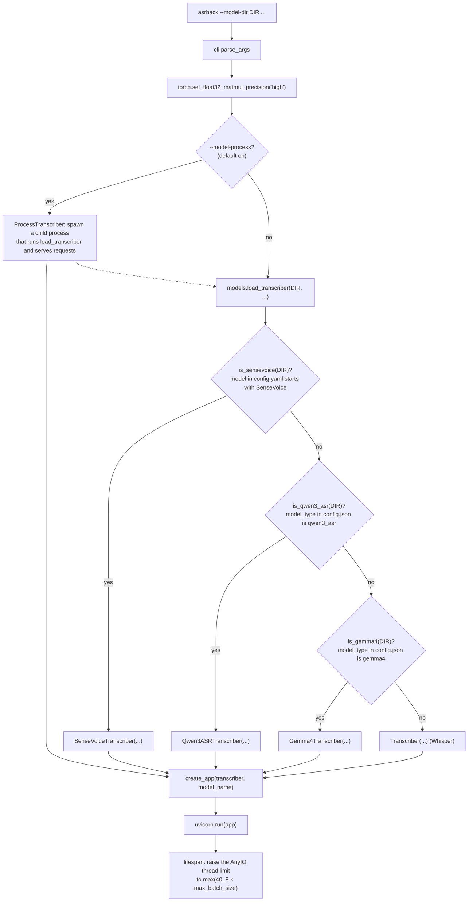

1. **Argument parsing** (`cli.parse_args`): `--max-batch-size` defaults to `None`, which means the
   model's own default (16 for Whisper, 32 for SenseVoice, 64 for Qwen3-ASR or 32 in float32,
   32 for Gemma 4 or 16 in float32).
2. **Model process** (`model_process.ProcessTranscriber`, on by default): the steps below run in a
   child process started with `spawn`. The server process keeps only a proxy with the same interface
   (`transcribe`, `languages`, `max_batch_size`, ...); errors while loading are sent back and raised
   in the server process, so the CLI handles them the same way. `--no-model-process` loads the model
   in the server process.
3. **Model selection** (`models.load_transcriber`): options left as `None` are dropped. If the
   `model` value in `config.yaml` starts with `SenseVoice`, the directory is a SenseVoice checkpoint;
   if `model_type` in `config.json` is `qwen3_asr`, a Qwen3-ASR checkpoint; if it is `gemma4`, a Gemma 4
   checkpoint; otherwise it is treated as Whisper. Passing `--cuda-graphs` or `--condition-on-previous-text` with SenseVoice, or
   `--compile-encoder` or `--condition-on-previous-text` with Qwen3-ASR or Gemma 4, raises `ValueError`, which the
   CLI turns into an exit with the message (`SystemExit`).
4. **Transcriber construction**: the weights are loaded and moved to the device and dtype, the
   model-specific preparation below runs, and **one decoding worker thread is started.** Only that
   thread touches the model.
   - Whisper: token ids (start of transcript, languages, tasks, `<|notimestamps|>`, ...) and the
     suppression masks are built once. With CUDA graphs on, the decoder cache and state buffers are
     allocated at the maximum batch size and one decoder step is captured for every
     (batch bucket × KV length bucket) pair. With `--compile-encoder`, the encoder is compiled for every
     batch bucket up front.
   - SenseVoice: `config.yaml`, the BPE model and `am.mvn` (CMVN statistics) are read, and `model.pt`
     is loaded with `torch.load(weights_only=True)`. With `--compile-encoder`, each encoder layer is
     compiled with `torch.compile(dynamic=True)`, so the identical layers share a graph and batches
     keep their own shapes; a warm-up compiles a batch of one and batches with and without a mask.
   - Qwen3-ASR: the model is built on the `meta` device and takes the SafeTensors tensors (one file or
     the shards of `model.safetensors.index.json`) in place of its parameters, so no memory is spent
     on random initialization. The tokenizer is assembled from `vocab.json`, `merges.txt` and the added
     tokens of `tokenizer_config.json`; the chat-template pieces, the RoPE tables, the KV cache and the
     state buffers are built once, and with CUDA graphs on one decoder step is captured for every
     (batch bucket × KV length bucket) pair, sharing one memory pool.
   - Gemma 4: as for Qwen3-ASR, but the tensors are read straight to the device, the vision tower is
     skipped, and the per-layer embedding table stays in host memory (section [8](#8-gemma-4-inference)).
     The tokenizer is `tokenizer.json`.
5. **App creation and run** (`server.create_app`, `uvicorn.run`): when the app starts (lifespan), the
   AnyIO default thread limit (40) is raised to at least `8 × max_batch_size`. Section
   [4](#4-concurrency-model) explains why.

## 3. Request handling

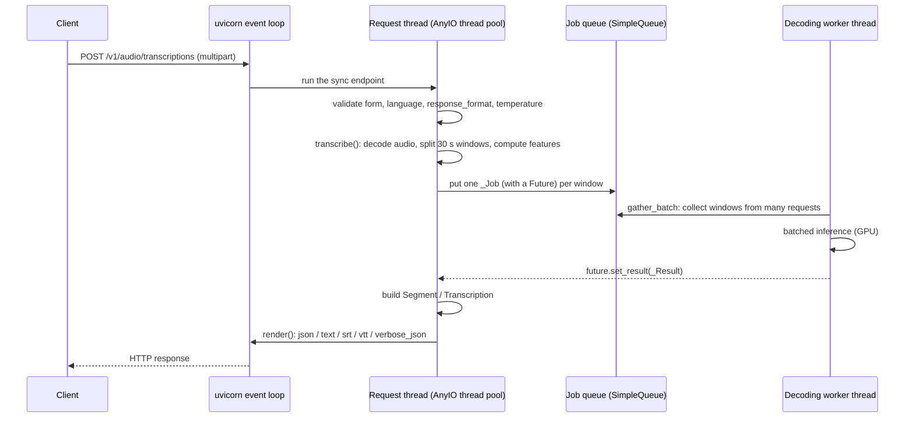

Endpoints (`server.py`):

| Endpoint | Handling |
| --- | --- |
| `POST /v1/audio/transcriptions` | 400 if `timestamp_granularities[]` contains `word`, or if `language` is not supported. Then `run(..., task="transcribe")` |
| `POST /v1/audio/translations` | `run(..., task="translate")`. Models that cannot translate (`*.en`, SenseVoice, Qwen3-ASR) raise `ValueError` in `transcribe()`, which becomes a 400 |
| `GET /v1/models`, `GET /v1/models/{id}` | Lists the single loaded model (id from `--model-name` or the directory name). The request's `model` field is ignored |
| `GET /health` | `{"status": "ok"}`, or 503 when the model process has exited (`--model-process`) or the decoding worker has stopped |

The shared handler `run()`:

0. With `--max-concurrent-requests N` (default 512), the `ConcurrencyLimit` middleware has already
   answered 429 (`Retry-After: 1`) if N audio requests were in flight. It runs before the multipart
   body is read, so rejected uploads cost nothing. Other paths (`/health`, `/v1/models`) are not
   counted. Next, with `--max-upload-mb N` (default 512), the `BodySizeLimit` middleware answers 413
   to a body over the limit: by its `Content-Length` before reading it, or, for a chunked body, as
   soon as the bytes received pass the limit (the response of the interrupted body parser is
   replaced).
1. Checks that `response_format` is one of `json`, `text`, `srt`, `vtt`, `verbose_json` and that
   `temperature` is between 0 and 1.
2. Reads the whole upload into bytes. An empty file is a 400.
3. Calls `transcriber.transcribe(audio_bytes, temperature=..., language=..., task=..., prompt=...)`,
   which blocks the request thread until the result is ready. A `ValueError` becomes a 400, a
   `ModelUnavailableError` (stopped worker or model process) a 503, and any other exception is
   logged and becomes a 500, all in the OpenAI error format.
4. Formats the result with `render()` (section [9](#9-responses)).

The endpoints are plain `def`, not `async def`, so the event loop stays responsive while a request
waits for inference: FastAPI runs sync endpoints in the AnyIO thread pool.

## 4. Concurrency model

Both transcribers share this structure:

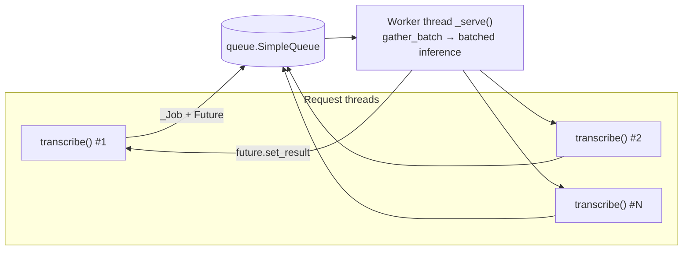

- **Request threads** validate input, decode audio (`asrfront.load`), split it into 30-second windows
  and compute features (log-mel or fbank). Feature extraction is CPU work, so it runs in parallel across
  request threads and overlaps with the worker's GPU work.
- **The worker thread** collects jobs from the queue into batches, runs the model and puts each job's
  result into its `Future`. It is the only thread that touches the model and its caches, so no lock is
  needed.
- **Batch collection** (`transcription.gather_batch`): wait for one job, then take more until
  `max_batch_size` is reached or `batch_wait_ms` (default 5 ms) has passed. Jobs that queued up while the
  GPU was busy with the previous batch are taken without waiting.
- **AnyIO thread limit**: each request holds a thread while it waits for its result. With the default
  limit of 40, at most 40 requests can wait inside the server, so batches fill less and SenseVoice has
  fewer windows to group by length. The lifespan hook therefore raises the limit to
  `8 × max_batch_size` (at least 40).
- **Out of memory**: when encoding and prefilling new windows (Whisper, Qwen3-ASR, Gemma 4) or
  launching a batch (SenseVoice) raises `torch.OutOfMemoryError`, the windows are retried in halves
  (`transcription.split_on_out_of_memory`) down to one window, so one large batch does not fail every
  request in it. SenseVoice launches the older half and puts the rest back at the front of its queue.
- **Errors**: if batched inference raises, the same exception goes into every `Future` of that batch.
  The worker then calls `raise_if_device_failed` (a `torch.cuda.synchronize`). After an error that
  leaves the device usable, such as an out-of-memory, the synchronize succeeds and the worker keeps
  running. After an error that poisons the CUDA context, such as an illegal memory access, it raises
  again and the worker stops: otherwise every later request would fail on a device that cannot recover.
- **A stopped worker** (`transcription.Worker`): request threads wait on their `Future` through
  `Worker.wait`, which checks every second (`WAIT_POLL_SECONDS`) that the worker still runs. If the
  worker has stopped, waiting requests and later ones raise `ModelUnavailableError` (503) instead of
  waiting forever, and the transcriber's `alive` is false, so `/health` answers 503.
- **Exit on failure**: `cli.serve` checks `alive` every second (`WATCH_SECONDS`). Once the model can
  no longer serve, it stops uvicorn, and the CLI exits with status 1 for a supervisor to restart it.
- **Audio length**: with `--max-audio-seconds` (default 3600), `transcription.load_audio` passes the limit to
  `asrfront.load(max_duration=...)`, which raises `ValueError` (400) before most of a long file is
  decoded. A waveform passed as an array is checked by its length.

### 4.1 Model process (`--model-process`, default)

With the model in the server process, the uvicorn event loop (HTTP parsing and `python-multipart`,
both pure Python) holds the GIL most of the time, and the worker thread waits for it before
launching each batch's kernels. On LibriSpeech test-clean with SenseVoice, the GPU was then busy only
about 60% of the time.

`ProcessTranscriber` moves everything above into a child process:

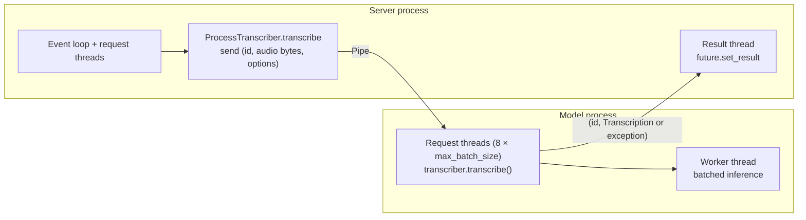

- Only the upload's bytes and the `Transcription` cross the pipe; audio decoding and feature extraction
  happen in the model process, where they release the GIL.
- Exceptions from `transcribe()` (for example the `ValueError` of an unsupported task) are sent back and
  raised by the caller, so they become 400s as before.
- The model process ignores SIGINT and is a daemon: it stops with the server process, and it exits when
  the pipe closes. It also exits when its decoding worker stops (a watch thread checks `alive` every
  second), so the server process sees the pipe close. If it dies, pending and later requests fail
  with `ModelUnavailableError` (503), `/health` answers 503, and the server exits with status 1.
- Measured with a lightweight multi-process client on LibriSpeech test-clean (RTX 5060 Ti): SenseVoice
  11.1–11.5 s → 9.4–9.5 s (GPU busy 64% → 77%); whisper-small 60.8 s → 59.3 s (already GPU-bound).

## 5. Whisper inference

Implementation: `models/whisper.py`. The network (`WhisperForConditionalGeneration`) and decoding
(`Transcriber`) live in the same file.

### 5.1 Request thread: `Transcriber.transcribe`

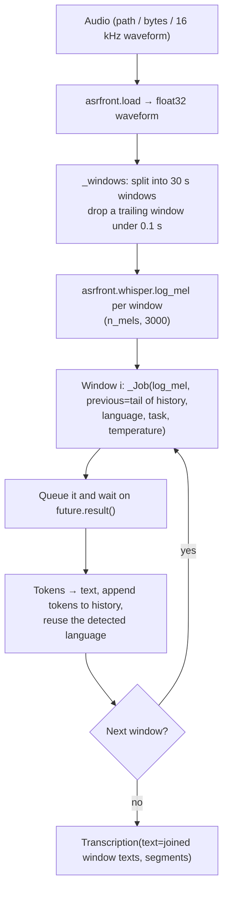

- **Window order**: windows are queued **one at a time**, because each window is conditioned on the
  text of the previous ones (`history`). As in openai-whisper, at most half the context
  (`max_target_positions // 2 - 1` tokens) is carried over. A `prompt` seeds `history`.
- **`--no-condition-on-previous-text`**: every window gets only the `prompt` as previous text, so all
  windows have the same prefix length and are queued at once to share batches. When no language is
  given, the first window is decoded alone to detect it, then the rest are queued.
- **Language**: the language detected in the first window is used for the rest.
- **Segments**: one `Segment` per window. `start` and `end` are the window bounds in seconds, and
  `compression_ratio` is the zlib compression ratio of the text.

### 5.2 Worker: continuous batching

The worker decodes in a pool of `max_batch_size` rows. A window takes a free row, decodes there until
EOS or its token budget, and frees the row; other windows keep decoding meanwhile, so a batch never
waits for its longest row, and windows with different prompt lengths decode together.

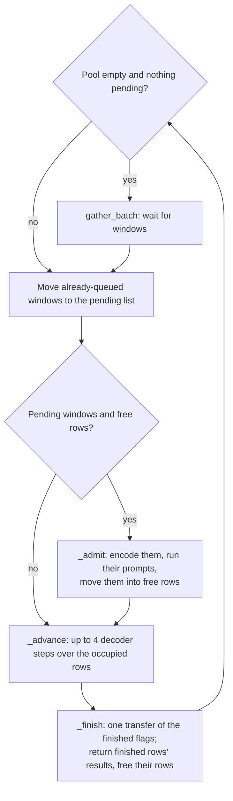

- `prefix = [<|startofprev|>, ...previous]` (when there is previous text)
  `+ [<|startoftranscript|>, <|lang|>, <|task|>, <|notimestamps|>]`
- English-only (`*.en`) models start with `[<|startoftranscript|>, <|notimestamps|>]`, without language
  or task tokens.
- `limit = min(max_new_tokens or the remaining room, max_target_positions - prefix_length)`; a row may
  write up to position `end = prefix_length - 1 + limit`.
- Free rows are marked finished at position 0, so steps leave them alone. Rows past the highest occupied
  one are not computed: the step runs over the smallest batch bucket that covers it.

### 5.3 Worker: admitting windows and decoder steps

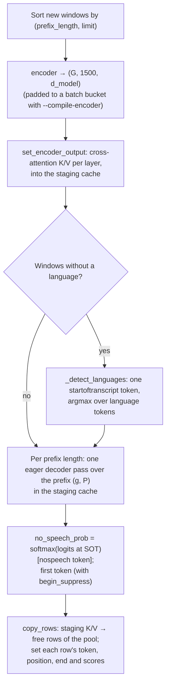

**The decoder caches** (`DecoderCache`) are four preallocated tensors shaped
`(layers, batch, heads, length, head_dim)`: the pool, and a staging cache of the same size where new
windows run their prompt pass with rows side by side. The pool's tensors never move, so its steps can be
captured as CUDA graphs. In a step, each row writes its self-attention key and value at its own position
(`scatter_`) and attends to positions up to it (a `(batch, 1, 1, length)` mask).

**The decoding state** (`_DecodeState`) holds, per row, the current token, its position, the last
position it may write, whether it has finished, the sum of log-probabilities, `no_speech_prob` and a
buffer of generated tokens. One step (`_step` → `_choose`) does all of this on the GPU:

1. Decode each row's current token at its position to get logits for the next token.
2. Apply the suppression mask (configured `suppress_tokens` and every timestamp token).
3. Pick the token by greedy argmax, or by sampling for rows with temperature > 0.
4. For rows still decoding: add the log-probability, write the token to `generated` at the next position
   and advance; mark rows that produced EOS or reached `end` as finished. Finished and free rows keep
   their token and position.

**CUDA graph path** (the default, when every occupied row is greedy):

- One step is captured in advance for every (batch bucket × KV length bucket) pair.
  - Batch buckets: powers of two up to `max_batch_size` (1, 2, 4, 8, 16).
  - KV length buckets: 64, 128, 256 and 448 (`max_target_positions`). The host tracks an upper bound of
    each row's position and picks the shortest bucket that covers the next 4 steps of every row.
- The host synchronizes only in `_finish`, every `EOS_CHECK_INTERVAL` (4) steps. Admitting windows needs
  no transfer: `no_speech_prob` stays on the GPU until the row finishes.
- While any occupied row has temperature > 0, the steps run eagerly.

**Eager path** (CPU, `--no-cuda-graphs`, sampling): calls the same `_step` directly.

**Results**: for the finished rows, `generated`, positions and scores are moved to the CPU in one
transfer per tensor; a row's tokens run from `prefix_length` to its position, without the final EOS.
`avg_logprob = sum of log-probabilities / (tokens + 1)`, counting EOS as openai-whisper does.

**Errors**: if admitting fails, those windows fail and their rows are freed. If a step fails, every
occupied row fails and the pool is reset; the worker keeps running.

### 5.4 Network

| Part | Details |
| --- | --- |
| Input | log-mel `(B, n_mels, 3000)`; `n_mels` is 80 (128 for the large-v3 family) |
| Encoder | conv1 (k=3) → GELU → conv2 (k=3, stride 2) → GELU → position embedding → N Transformer blocks → LayerNorm; output `(B, 1500, d_model)` |
| Decoder | token + position embedding → N × (self-attention → cross-attention → MLP) → LayerNorm |
| Output | linear layer sharing the token embedding weights (`logits`) |
| Attention | `F.scaled_dot_product_attention` (unmasked in the encoder, `is_causal` for the decoder prefix) |
| Weights | names match Hugging Face `model.safetensors` (`model.encoder...`, `model.decoder...`) |

## 6. SenseVoice inference

Implementation: `models/sensevoice.py`, a plain PyTorch reimplementation of FunASR's SenseVoiceSmall.

### 6.1 Request thread: `SenseVoiceTranscriber.transcribe`

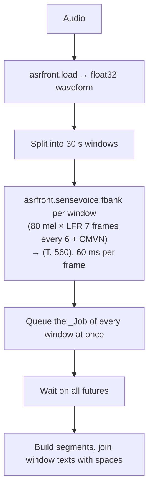

Unlike Whisper, windows do not depend on each other, so **all windows are queued at once** and the
windows of a long recording can share a batch. `prompt` and `temperature` are unused (greedy CTC), and
translation is not supported.

### 6.2 Worker: grouping windows of similar length

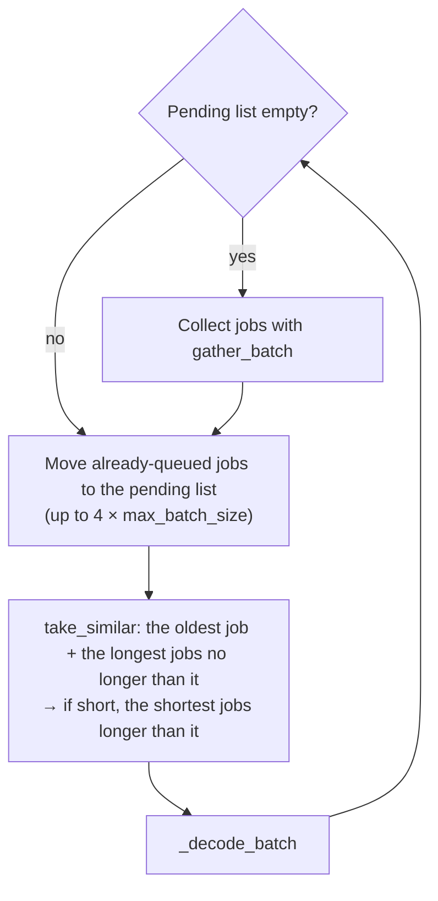

A batch is padded to its longest window, so mixed lengths waste computation. `take_similar` anchors on
the job that has waited longest and fills the batch **with shorter jobs first**, since they do not raise
the batch's maximum length. The anchor is always included, so no job waits forever. The more requests
wait inside the server (the more are in flight), the more candidates there are and the better the
grouping.

### 6.3 Worker: `_decode_batch`

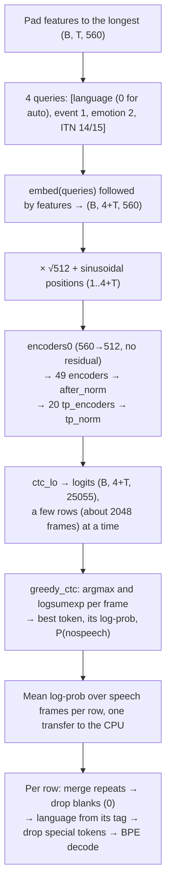

- **Mask**: when every row has the same length, no mask is used. Otherwise a `(B, 4+T)` mask hides
  padding frames from the FSMN input and from attention keys. Batching rows of different lengths gives
  the same results as decoding them one by one.
- **SAN-M attention**: one linear layer produces Q, K and V; the output is attention plus an FSMN
  memory, a depthwise convolution (k=11) over V. Without a mask, attention is
  `F.scaled_dot_product_attention` (flash attention on CUDA). With one, SDPA would fall back to the
  memory-efficient kernel, about 2.5× slower, so on CUDA with bfloat16 the padded batch goes to
  `varlen_attn` (flash attention for variable-length sequences) instead: rows are laid out back to back
  and `seqused_k` stops each row's keys at its length. `varlen_supported()` checks at startup that it
  runs on the device; otherwise (CPU, float32) masked SDPA is used.
  cuDNN attention is as fast with a mask but builds a plan for every new shape (about 36 ms each),
  which costs more than it saves with LibriSpeech's varying lengths.
- **Reading the output**: the CTC output at the first four frames carries a language tag such as
  `<|en|>` and emotion, event and ITN tags. The language tag gives the detected language, and every
  `<|...|>` special token is removed from the text.
- **ITN**: `withitn` (14) by default, so the output includes punctuation and number normalization.
- **dtype**: activations reach about 71,000 in the last layers, beyond the float16 maximum (65,504), so
  the CUDA default is bfloat16.

## 7. Qwen3-ASR inference

Implementation: `models/qwen3_asr.py`, a plain PyTorch reimplementation of the Qwen3-ASR checkpoints
(0.6B and 1.7B: an audio encoder and a Qwen3 language model). The decoding worker follows Whisper's
continuous batching (section [5.2](#52-worker-continuous-batching)).

### 7.1 Request thread: `Qwen3ASRTranscriber.transcribe`

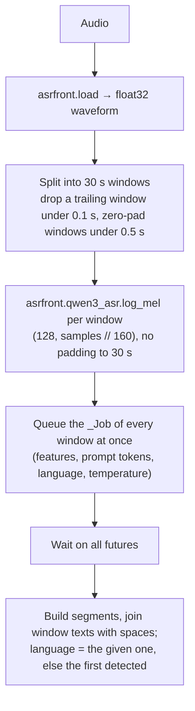

- **Windows** are independent, as for SenseVoice, so the windows of a long recording share batches.
- **`prompt`** is tokenized once and becomes the system message of every window (its last 224 tokens).
- **`language`** (ISO code, mapped to the model's name such as `Korean`) is optional; translation is not
  supported.

### 7.2 The prompt and the output

Qwen3-ASR's chat template, with `N = asrfront.qwen3_asr.num_audio_tokens(frames)` audio placeholders
(13 per 100 frames, about 13 per second):

```
<|im_start|>system\n{prompt}<|im_end|>\n
<|im_start|>user\n<|audio_start|><|audio_pad|> × N<|audio_end|><|im_end|>\n
<|im_start|>assistant\n[language Korean<asr_text>]
```

The model writes `language <Name><asr_text><transcript>` and stops at `<|im_end|>` or `<|endoftext|>`.
With a request language, `language <Name><asr_text>` is already part of the prompt and the model writes
only the transcript. `_parse`, run by the request's thread rather than the worker, takes the language from the tokens before `<asr_text>` (`language None`,
the model's answer for audio without speech, sets `no_speech_prob` to 1); the text is the rest, decoded,
with repeated characters or short patterns (more than 20 times in a row) collapsed as qwen-asr does.
`avg_logprob` counts every generated token, including the language prefix and the end token.

### 7.3 Worker: admitting windows

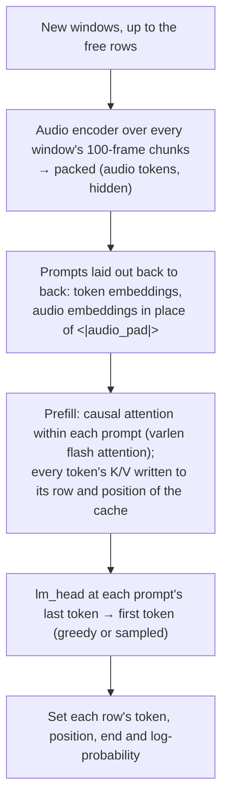

- **Packing**: prompts differ in length (the audio part grows with the window), so they are not padded:
  linear layers run on all tokens at once and `varlen_attn` keeps each prompt's attention to itself.
  On CPU or with float32, the same call becomes one padded `scaled_dot_product_attention` with a mask.
- **No waiting on the GPU**: token ids, cache rows and positions, the indices of the audio tokens and of
  each chunk's valid tokens are built with NumPy and copied from pinned memory (`to_device`). A copy
  from pageable memory, or a boolean mask on the GPU, would wait for every step queued before it.
- **Convolutions** run 64 chunks at a time; the checkpoint's `conv_chunksize` (500) needs about 3 GB of
  activations at once, which leaves less room for the KV cache.
- **The KV cache** (`KVCache`) is two preallocated tensors shaped
  `(layers, max_batch_size, 1024, kv_heads, head_dim)`. A row's prompt and generated tokens share its
  1024 positions; `limit = min(max_new_tokens or 512, 1024 - prompt_length)`.

### 7.4 Worker: decoder steps

As in Whisper (section [5.3](#53-worker-admitting-windows-and-decoder-steps)): `_advance` runs up to 4
steps over the smallest batch bucket that covers the occupied rows, from a CUDA graph when every
occupied row is greedy; `_finish` transfers the finished flags once and returns the finished rows'
tokens.

One step decodes each row's token at its own position, and the key and value go to that position of
the row. With CUDA and bfloat16, the query attends with `varlen_attn` over the row's whole cache
(flattened to `(rows × 1024, kv_heads, head_dim)`) with `seqused_k = position + 1`, so it reads only
the keys the row has, and the key/value heads are split in 4 parts (`num_splits`), which was about 20%
faster than the kernel's own choice. Otherwise it attends through a `(batch, 1, 1, length)` mask over
the shortest KV length bucket (128, 256, 512, 768, 1024) that covers the next steps; the query heads
that share a key/value head (grouped-query attention, 16 query and 8 key/value heads) are passed to
`scaled_dot_product_attention` as one group of queries for that head, so no keys are repeated.

### 7.5 Network

| Part | Details |
| --- | --- |
| Input | Whisper-style log-mel `(128, frames)`, 100 frames per second |
| Audio encoder | per 100-frame chunk (the last zero-padded): 3 × (Conv2d k=3 stride 2 → GELU) → linear → sinusoidal positions restarting in every chunk → 13 tokens; Transformer layers (18 for 0.6B, 24 for 1.7B) attending within windows of 8 chunks (8 s, 104 tokens) → LayerNorm → linear → GELU → linear to the LLM width |
| Language model | Qwen3: RMSNorm, attention with per-head RMSNorm on queries and keys, RoPE (θ = 10⁶; the multimodal RoPE reduces to it for text positions), SwiGLU MLP; 28 layers |
| Output | `lm_head` (not tied to the embeddings in these checkpoints) |
| Weights | names match the Hugging Face checkpoint (`thinker.audio_tower...`, `thinker.model...`, `thinker.lm_head`), except that the language model's `q_proj`/`k_proj`/`v_proj` and `gate_proj`/`up_proj` are joined into `qkv_proj` and `gate_up_proj` when loaded |

The encoder attends within 8-second windows (`n_window_infer`), as qwen-asr's vLLM backend and its
transformers backend with flash attention do. Its transformers backend with SDPA ignores those windows
and attends over the whole input; on FLEURS with 0.6B the two give the same error rates (ko 3.97% vs
3.91%, ja 8.49% vs 8.56% CER). In float32, the transcripts match the transformers backend with the
window mask exactly on a sample of LibriSpeech and FLEURS files.

## 8. Gemma 4 inference

Implementation: `models/gemma4.py`, a plain PyTorch reimplementation of the audio path of the Gemma 4
E2B and E4B checkpoints (`google/gemma-4-E2B-it`, `google/gemma-4-E4B-it`: a USM-style audio encoder
and the Gemma 4 language model; the vision tower is not loaded). The decoding worker follows Qwen3-ASR's
continuous batching (section [7](#7-qwen3-asr-inference)), with one step at a time.

### 8.1 Request thread: `Gemma4Transcriber.transcribe`

The audio is split into 30-second windows (the model's limit; a trailing window under 0.1 s is dropped,
a window under 0.1 s zero-padded), and `asrfront.gemma4.log_mel` computes each window's
`(frames, 128)` features (`(samples - 1) // 160` valid frames). Every window's `_Job` is queued at once
and the window texts are joined with spaces. `prompt` becomes the system message (its last 224
tokens). `language` is optional: the prompt names it (`ko` → `Korean`) or asks for the original
language; the response's `language` is the request's, or `unknown`. Translation is not supported.

### 8.2 The prompt and the output

The model card's ASR prompt, with the audio after the text and
`N = asrfront.gemma4.num_audio_tokens(frames)` audio placeholders (one per 40 ms, at most 750):

```
<bos>[<|turn>system\n{prompt}<turn|>\n]
<|turn>user\nTranscribe the following speech segment in {Language} into {Language} text.\n\n
Follow these specific instructions for formatting the answer:\n
* Only output the transcription, with no newlines.\n
* When transcribing numbers, write the digits, i.e. write 1.7 and not one point seven, and write 3 instead of three.
<|audio><|audio|> × N<audio|><turn|>\n
<|turn>model\n
```

Without a language, the first sentence is `Transcribe the following speech segment in its original
language.` The model writes the transcript and stops at `<eos>`, `<turn|>` or `<|tool_response>`
(`generation_config.json`); the text is the tokens decoded without special tokens. The prompt tokens
are the ones `Gemma4Processor.apply_chat_template` builds for the same messages.

### 8.3 Worker: admitting windows and decoder steps

- **Admission**: new windows are prefilled in groups of up to 8 (`PREFILL_ROWS`, which bounds the
  activations and the per-layer embeddings copied over). The group's features are zero-padded to the
  longest and encoded together (an item's valid tokens do not depend on the padding: the attention is
  local and only looks back, and the convolutions read zeroed frames past each item). Prompts form
  one padded batch; the audio embeddings replace the `<|audio|>` embeddings, and attention runs through
  `scaled_dot_product_attention` with a causal mask (and the 512-token window on sliding layers) that
  stops at each prompt's length. Every layer with its own keys and values writes them to its row of
  the cache.
- **Per-layer embeddings**: every layer adds an input of its own, made from a projection of the token
  embeddings and a lookup in `embed_tokens_per_layer` (262144 × layers × 256: 4.7 GB for E2B, 5.6 GB
  for E4B in bfloat16). That table stays in host memory, as the "effective" parameter count intends,
  which lets E4B run on a 16 GB GPU; the rows of a batch's tokens are looked up there and copied over.
  Audio positions look up the padding token, as transformers does.
- **Decoder steps**: each step reads the rows' latest tokens on the host, looks up their per-layer
  embeddings into a pinned buffer, copies them and the positions into fixed-address inputs, and replays
  the CUDA graph of the smallest (batch bucket × KV length bucket: 256, 512, 768, 1024, 1280) pair; the
  graph writes the logits, and the token is chosen outside it (greedy or sampled). The host reads the
  tokens back after every step, so EOS and length checks cost nothing extra.
- **The KV cache** (`LayerKV`) holds `(max_batch_size, 1280, kv_heads, head_dim)` keys and values for
  each layer with its own; a row's prompt (about 820 tokens for 30 s) and generated tokens share them;
  `limit = min(max_new_tokens or 448, 1280 - prompt_length)`. The last `num_kv_shared_layers` layers
  (20 of 35 in E2B, 18 of 42 in E4B) have no keys and values: they attend over those of the last earlier
  layer of their type, so they share its cache.

### 8.4 Network

| Part | Details |
| --- | --- |
| Input | log-mel `(frames, 128)`, 100 frames per second, `log(mel + 0.001)` |
| Audio encoder | 2 × (Conv2d k=3 stride 2 → LayerNorm → ReLU) → linear (25 tokens per second); 12 Conformer layers (half-step SiLU feed-forward, local attention, causal depthwise light convolution, half-step feed-forward, RMSNorm) with clamped linear layers; linear to 1536 |
| Audio attention | blocks of 12 tokens; each token attends to itself and the 11 before it, with Transformer-XL relative position scores against sinusoids of the distances, logits soft-capped at 50 |
| Audio embedder | RMSNorm without weight → linear to the language model width |
| Language model | Gemma 4: embeddings × √width; sliding-window (512, RoPE θ = 10⁴, head_dim 256) and full-attention layers (proportional RoPE θ = 10⁶ on a quarter of the frequencies, head_dim 512); RMSNorm on queries, keys and values, attention without scaling; RMSNorm after attention and MLP; GELU-tanh gated MLP (twice as wide in the KV-shared layers of E2B); per-layer input gate; a per-layer scalar |
| Output | the tied embedding matrix, logits soft-capped at 30 |
| Weights | names match the Hugging Face checkpoint (`model.audio_tower...`, `model.embed_audio...`, `model.language_model...`), except that `q_proj`/`k_proj`/`v_proj` and `gate_proj`/`up_proj` are joined into `qkv_proj` and `gate_up_proj`, and the KV-shared layers' unused key and value weights are dropped |

In float32 the audio embeddings match transformers' (5.20's `Gemma4AudioModel`) to about 1e-4
relative error; in bfloat16 the greedy transcripts of a sample of LibriSpeech and FLEURS ko files are
token-for-token those of transformers' `generate`.

## 9. Responses

`server.render()` turns a `Transcription` into the requested format:

| Format | Content |
| --- | --- |
| `json` | `{"text": ...}` |
| `text` | the text plus a newline |
| `verbose_json` | `task`, `language`, `duration`, `text`, `segments` (id, seek, start, end, text, tokens, temperature, avg_logprob, compression_ratio, no_speech_prob) |
| `srt`, `vtt` | one subtitle block per window segment (`HH:MM:SS,mmm` / `HH:MM:SS.mmm`) |

Segments are 30-second windows; there are no word-level timestamps.

## 10. Evaluation tool (asrback-eval)

Implementation: `evaluation.py`. It sends requests to a running server through the OpenAI client from
several client processes and measures error rates in the main process.

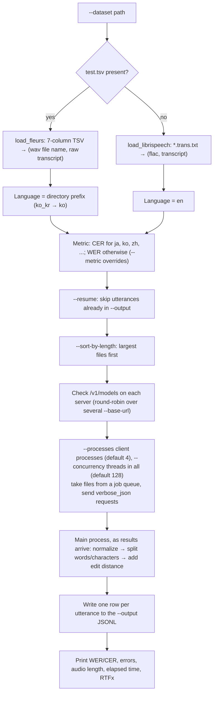

- **Normalization**: Whisper's `EnglishTextNormalizer` for English and `BasicTextNormalizer` for other
  languages. Without `openai-whisper`, a basic fallback lowercases the text and turns punctuation and
  symbols into spaces.
- **CER**: spaces are removed from the normalized text and the edit distance is computed over characters.
- **Resume**: `--resume` rewrites the rows of the earlier output file and includes them in the score; a
  file scored with a different metric is refused.
- **Timing**: `RTFx = total audio duration / elapsed time`, excluding utterances skipped by `--resume`.
  The clock starts once every client process has imported the OpenAI client and is ready.
- **Client processes**: the OpenAI client spends enough CPU per request that one process (with the GIL)
  could not keep up with the SenseVoice server: on LibriSpeech test-clean, 1 process took 13.5 s and
  2–8 processes 10.5–10.8 s. A failed request stops the run with exit code 1, and Ctrl-C stops the
  client processes and exits with 130.
- **Concurrency**: keep `--concurrency` well above the server's `max_batch_size` so batches fill and
  SenseVoice can group windows of similar length.

## 11. Interactive client (asrback-client)

Implementation: `client.py`. It reads audio file paths at a prompt, sends them to the server and prints
the results.

1. Takes `--task` (transcribe/translate), `--language`, `--prompt` and `--response-format`.
2. Enables readline path completion and accepts quoted paths (from drag and drop).
3. For each path, calls `audio.transcriptions` or `audio.translations` and prints the response and the
   time it took.
4. Prints the status code and message on API errors, or a hint on connection failures, then waits for
   the next path.

## 12. Error handling

| Situation | Handling |
| --- | --- |
| Missing model files, invalid option combinations | `FileNotFoundError` / `ValueError` at startup → the CLI exits with the message |
| Form validation failure (missing required field, ...) | `RequestValidationError` → 400 in the OpenAI `{"error": {...}}` format |
| Unsupported language, format or temperature; empty file; word timestamps requested | `APIError` → 400 |
| Task the model cannot do (translation) | `ValueError` from `transcribe()` → 400 |
| Unknown model id | 404 |
| Audio longer than `--max-audio-seconds` | `ValueError` from `load_audio` → 400 |
| More than `--max-concurrent-requests` audio requests in flight | 429 with `Retry-After: 1`, before the upload is read |
| Upload larger than `--max-upload-mb` | 413, by `Content-Length` or once a chunked body passes the limit |
| Out of memory while admitting new windows | Retried in halves down to one window; only a window that does not fit alone fails (500) |
| Exception during batched inference | The same exception reaches every request of that batch (Whisper, Qwen3-ASR, Gemma 4: of every occupied row) and is logged; the request answers 500 in the OpenAI format; the worker keeps running if the device is still usable |
| Device error the CUDA context cannot recover from | The worker stops; waiting and later requests raise `ModelUnavailableError` (503) within a second, `/health` answers 503 (with `--model-process`, the model process exits), and the server exits with status 1 |
| Model process exited (`--model-process`) | Pending and later requests raise `ModelUnavailableError` (503); the server exits with status 1 |

## 13. Defaults

| Item | Whisper | SenseVoice | Qwen3-ASR | Gemma 4 |
| --- | --- | --- | --- | --- |
| dtype | bfloat16 (CUDA), float32 (CPU) | bfloat16 (CUDA), float32 (CPU) | bfloat16 (CUDA), float32 (CPU) | bfloat16 (CUDA), float32 (CPU) |
| `max_batch_size` | 16 | 32 | 64 (32 in float32) | 32 (16 in float32) |
| `batch_wait_ms` | 5 | 5 | 5 | 5 |
| Model process | on (`--no-model-process` to load in the server process) | on | on | on |
| CUDA graphs | on with CUDA (decoder steps) | none | on with CUDA (decoder steps) | on with CUDA (decoder steps) |
| `--compile-encoder` | off (optional; batch buckets) | off (optional; per layer, dynamic shapes) | not supported | not supported |
| Windows | 30 s windows in order, each conditioned on earlier text (`--no-condition-on-previous-text`: all at once) | 30 s windows all at once | 30 s windows all at once | 30 s windows all at once |
| Batching | continuous: rows join and leave a pool of `max_batch_size` every 4 steps | batches of similar length | continuous, as for Whisper; prompts prefilled packed | continuous, every step; prompts prefilled 8 at a time, padded |
| Decoding | greedy or temperature sampling | greedy CTC | greedy or temperature sampling, at most 512 new tokens | greedy or temperature sampling, at most 448 new tokens |
| Request limits | 3600 s of audio, 512 MB uploads, 512 requests in flight | same | same | same |
| Server thread limit | max(40, 8 × 16, 512) = 512 | max(40, 8 × 32, 512) = 512 | max(40, 8 × 64, 512) = 512 | max(40, 8 × 32, 512) = 512 |
| Eval concurrency | 128 requests from 4 processes | 128 requests from 4 processes | 128 requests from 4 processes | 128 requests from 4 processes |
